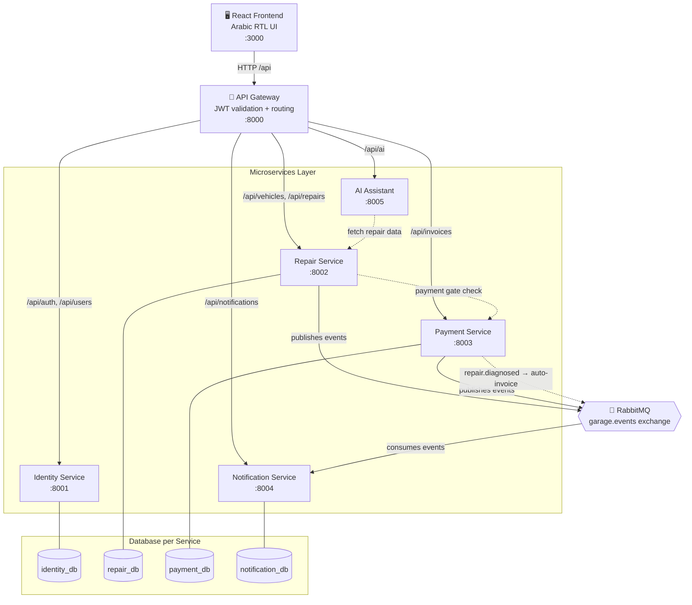
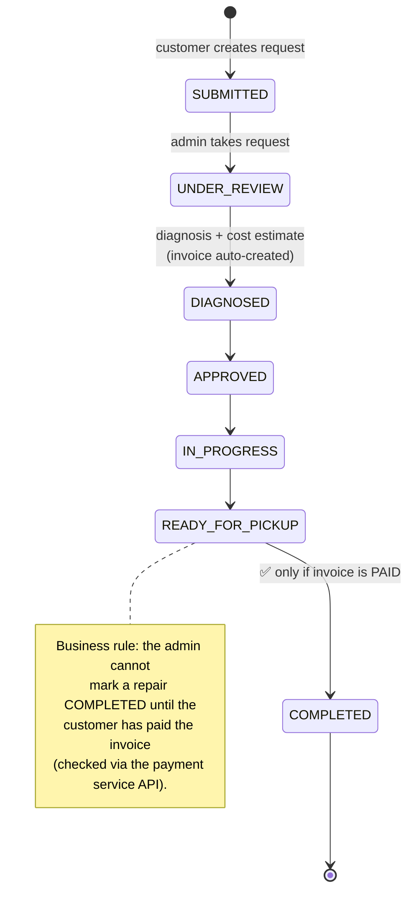
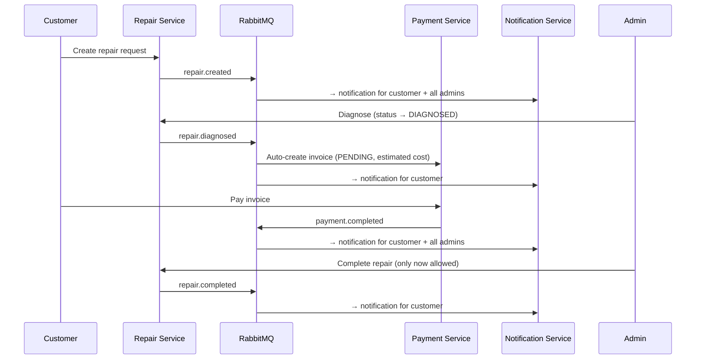

# 🚗 Garage Management System — Microservices Platform

A full-stack **car repair management platform** built on a real microservices architecture: 5 independent services, an API gateway, event-driven communication over RabbitMQ, and a database per service.

> 📄 For the full product description, problem statement, and feature walkthrough, see [`docs/PROJECT_DESCRIPTION.md`](docs/PROJECT_DESCRIPTION.md).

---

## Architecture



**Synchronous (REST):** Frontend ↔ Gateway ↔ Services · Repair → Payment (payment-gate check) · AI → Repair (fetching repair data)
**Asynchronous (RabbitMQ):** Repair/Payment publish events → Notification service creates notifications for customers and admins

---

## Microservices

| Service | Port | Responsibility | Database |
|---|---|---|---|
| **Identity** | 8001 | Registration, login, JWT issuing, `CUSTOMER`/`ADMIN` roles, bcrypt hashing | `identity_db` (Users) |
| **Repair** | 8002 | Vehicles, repair requests, photo uploads, the repair lifecycle state machine, payment-gated completion | `repair_db` (Vehicles, RepairOrders, RepairPhotos) |
| **Payment** | 8003 | Simulated invoicing & payments; auto-creates an invoice when a repair is diagnosed; publishes `payment.completed` | `payment_db` (Invoices) |
| **Notification** | 8004 | RabbitMQ event consumer → in-app notifications for customers **and admins** (admin recipients self-register) | `notification_db` (Notifications, AdminRecipients) |
| **AI Assistant** | 8005 | Explains diagnoses in natural language via Groq/OpenAI with a rule-based mock fallback | — (stateless) |
| **API Gateway** | 8000 | Single entry point: JWT validation at the edge, reverse proxying, `/api` prefix stripping | — |

Services **never** access each other's databases — all cross-service data flows through REST APIs or events.

---

## Repair Lifecycle



The state machine is strictly linear — invalid jumps (e.g. `SUBMITTED → COMPLETED`) are rejected with `400 INVALID_STATUS_TRANSITION`.

---

## Event-Driven Flow



### Events

| Routing key | Published by | Effect |
|---|---|---|
| `repair.created` | Repair | Customer + admin notifications |
| `repair.diagnosed` | Repair | Customer notification + **auto-invoice** in Payment |
| `repair.started` | Repair | Customer notification |
| `repair.ready` | Repair | Customer notification |
| `repair.completed` | Repair | Customer notification |
| `payment.completed` | Payment | Customer + admin notifications |

---

## Key Business Rules

- 🔒 **Payment-gated completion** — admins cannot set a repair to `COMPLETED` until the customer has paid (enforced server-side via a REST check to the payment service; fail-closed)
- 🔢 **Unique plate numbers** — vehicle plates are unique across the whole database (DB-level constraint; duplicates return `409 PLATE_EXISTS`)
- 📝 **Mandatory forms** — customer request fields and admin review fields (diagnosis, required work, estimated cost, expected pickup date) are required in the UI *and* validated server-side (all-or-nothing)
- 👥 **RBAC everywhere** — customers only access their own data; admin-only endpoints are enforced per service
- 🔔 **Admin notifications** — admins are notified of new repair requests and payments; dashboards and notification lists poll every 15 s

---

## Technology Stack

| Layer | Technology |
|---|---|
| Frontend | React, TypeScript, Vite, React Router, Axios (nginx in production) |
| API Gateway | Node.js, Express, http-proxy-middleware |
| Microservices | Node.js, TypeScript, Express |
| Database | PostgreSQL + Prisma ORM (database per service) |
| Messaging | RabbitMQ (topic exchange `garage.events`) + amqplib |
| AI | Groq API (Llama 3.1) / OpenAI-compatible, with mock fallback |
| Infrastructure | Docker + Docker Compose |

---

## Project Structure

```
├── frontend/                    # React application (nginx proxies /api → gateway)
├── gateway/                     # API Gateway
├── services/
│   ├── identity-service/        # Auth & users
│   ├── repair-service/          # Vehicles, repairs, lifecycle, payment gate
│   ├── payment-service/         # Invoices, simulated payments, auto-invoice consumer
│   ├── notification-service/    # Event consumer, customer + admin notifications
│   └── ai-service/              # AI repair assistant (Groq / mock)
├── docs/                        # Product description & design artifacts
├── scripts/                     # Admin creation helper
├── data/uploads/                # Uploaded vehicle photos (volume-mounted)
├── e2e-system-test.mjs          # End-to-end system test (62 checks)
├── TEST_REPORT.md               # Full test report
└── docker-compose.yml           # Full stack orchestration
```

---

## Quick Start

### Prerequisites
- Docker & Docker Compose

### Run

```bash
cp .env.example .env      # then fill in AI_API_KEY (optional — mock AI works without it)
docker compose up --build
```

| URL | What |
|---|---|
| http://localhost:3000 | Frontend (Arabic RTL UI) |
| http://localhost:8000/health | API Gateway health |
| http://localhost:15672 | RabbitMQ management UI (guest/guest) |

### Create the admin account

```bash
node scripts/create-admin.js   # prints SQL with a bcrypt hash
docker exec -it garage-postgres psql -U postgres -d identity_db
-- paste the INSERT statement from the script
```

Admin: `admin@garage.com` / `admin123` (after running the script)

> Migrations apply automatically at container startup (`prisma migrate deploy`).

---

## API Overview

| Method | Endpoint | Auth | Description |
|---|---|---|---|
| POST | `/api/auth/register` | — | Register customer |
| POST | `/api/auth/login` | — | Login (returns JWT) |
| GET | `/api/users/me` | JWT | Current user profile |
| POST/GET | `/api/vehicles` | JWT | Add / list own vehicles (unique plate) |
| POST | `/api/repairs` | JWT | Create repair request |
| GET | `/api/repairs`, `/api/repairs/:id` | JWT | List / view repairs (ownership-scoped) |
| PATCH | `/api/repairs/:id` | ADMIN | Update status/diagnosis/cost (review fields mandatory, payment-gated completion) |
| POST | `/api/repairs/:id/photos` | JWT | Upload photos (max 10, 5 MB) |
| GET | `/api/invoices/:id` | JWT | Invoice details (owner or admin) |
| POST | `/api/invoices/:id/pay` | JWT | Pay invoice (simulated, idempotent) |
| GET | `/api/invoices/customer/:customerId` | JWT | Customer's invoices |
| GET | `/api/notifications` | JWT | Latest 50 notifications |
| PATCH | `/api/notifications/:id/read` · `/read-all` | JWT | Mark read |
| POST | `/api/notifications/admins/register` | ADMIN | Register as notification recipient |
| POST | `/api/ai/chat` | JWT | Ask the AI about a repair |

All protected endpoints expect `Authorization: Bearer <token>`.

---

## Testing

The project ships with **123 passing checks** (see [`TEST_REPORT.md`](TEST_REPORT.md)):

**Unit & integration tests** (Jest + ts-jest + Supertest, 61 tests):

```bash
cd services/identity-service   && npm test
cd services/repair-service     && npm test
cd services/payment-service    && npm test
cd services/notification-service && npm test
```

**End-to-end system test** (62 checks against the live Docker stack — health, auth, RBAC, the full repair lifecycle, RabbitMQ event chains, payments, uploads, AI):

```bash
node e2e-system-test.mjs
```

---

## Docker Commands

```bash
docker compose up --build        # start everything
docker compose down              # stop
docker compose logs -f <service> # follow logs
docker compose down -v           # stop and wipe volumes
```

---

## Troubleshooting

- **Service not healthy** → `docker compose ps`, then `docker compose logs <service>`; each service exposes `GET /health`
- **RabbitMQ issues** → check the management UI (:15672) for the `garage.events` exchange and `notification-queue` / `payment-service-queue` bindings
- **Database issues** → migrations run automatically at startup; check `docker compose logs <service>` for `prisma migrate deploy` output
- **Frontend can't reach the API** → the nginx config proxies `/api` to the gateway; verify the gateway is up on :8000

---

*University project — Software Engineering course. For educational purposes.*
