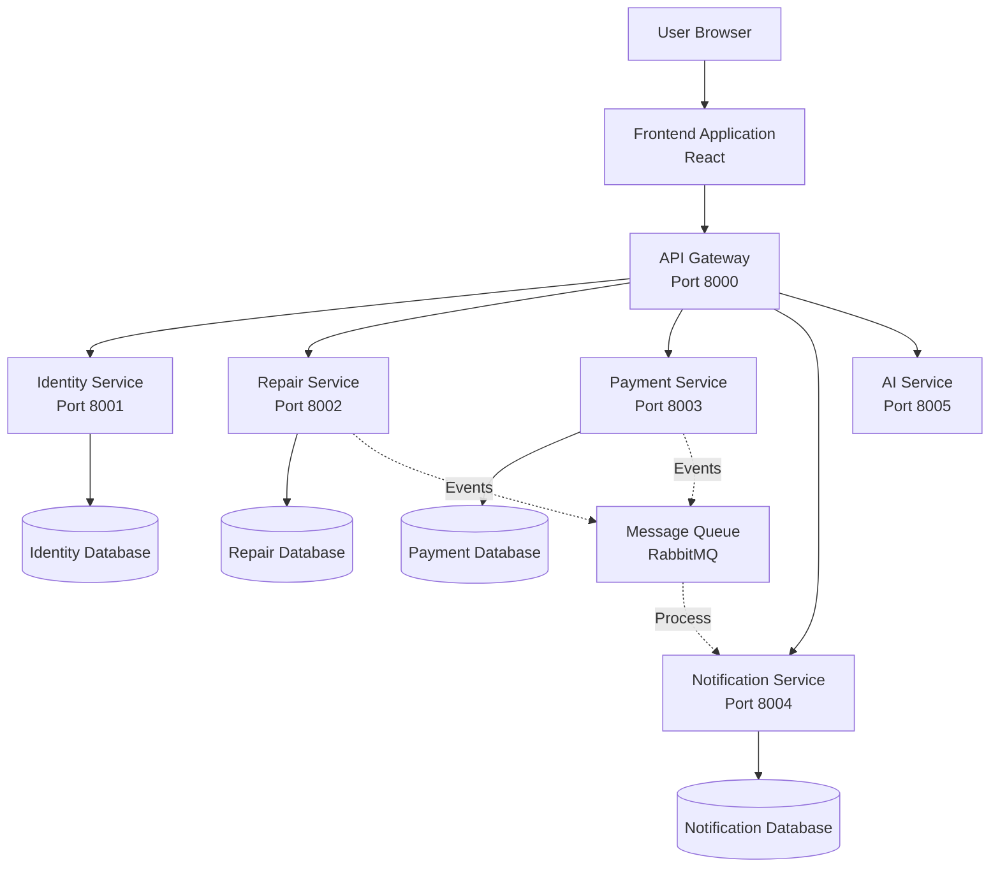

# Garage Management System - Project Description

## Overview

The Garage Management System is a comprehensive web application designed to digitize and streamline the entire vehicle repair process. It connects car owners with garage service providers through a transparent, real-time platform that tracks every step from initial repair request to final payment confirmation.

## The Problem

Traditional garage operations rely heavily on manual processes: phone calls, paper forms, sticky notes, and face-to-face interactions. This creates several challenges:

For customers, there's a lack of visibility into the repair process. They often don't know if their car has been looked at, what the actual problem is, or when they'll get a cost estimate. Communication happens through phone tag, and tracking payments can be confusing.

For garage owners, managing multiple repairs simultaneously becomes chaotic. Paper trails get lost, customers call repeatedly for updates, payment tracking is manual, and there's no efficient way to keep customers informed about their vehicle's status.

## The Solution

This system brings the entire repair workflow online, providing a centralized platform where all stakeholders can access real-time information. Customers can submit repair requests, track progress, and make payments from any device. Garage administrators can manage all incoming requests, update repair status, and handle payments through a unified dashboard.

The system automatically sends notifications at key milestones, eliminating the need for constant phone communication. Every action is logged, creating a complete audit trail for both parties.

## System Architecture

The application follows a microservices architecture pattern, where the system is divided into specialized, independent services that communicate through a central API gateway. This architectural approach provides scalability, maintainability, and fault tolerance.

### Service Responsibilities

**Identity Service** handles user registration, authentication, and authorization. It manages user accounts, validates credentials, and issues JWT tokens for secure API access.

**Repair Service** manages all repair-related operations including repair requests, vehicle information, status updates, and photo uploads. It maintains the complete lifecycle of repair orders.

**Payment Service** handles invoice generation, payment processing, and payment confirmation. It creates invoices automatically when repairs are diagnosed and manages the two-step payment verification process.

**Notification Service** listens to system events and creates appropriate notifications for users. It ensures customers and administrators stay informed about important updates without requiring manual communication.

**AI Service** provides intelligent analysis capabilities for cost estimation and problem detection, with the potential for predictive maintenance features.

**API Gateway** serves as the single entry point for all client requests, handling authentication, routing requests to appropriate services, and providing a unified API interface.

## Core Features

### User Management

The system supports two user roles: customers and administrators. Customers can register themselves, while administrators are created through database initialization scripts. Each user type has access to role-specific features and data.

Authentication uses industry-standard JWT tokens with bcrypt password hashing. The system enforces strict authorization rules, ensuring users can only access their own data unless they have administrative privileges.

### Vehicle Management

Customers can register multiple vehicles with complete details including make, model, year, license plate, and color. They can edit vehicle information at any time or remove vehicles that have no associated repair history.

The system enforces data integrity by preventing deletion of vehicles with existing repair orders. This ensures historical repair data remains accessible and consistent.

### Repair Workflow

The repair process follows a structured status progression:

1. **Submitted**: Customer creates a repair request with problem description and optional photos
2. **Under Review**: Initial admin assessment
3. **Diagnosed**: Problem identified with cost estimate
4. **Approved**: Customer approves the work
5. **In Progress**: Active repair work
6. **Ready for Pickup**: Work completed, awaiting customer
7. **Completed**: Customer has retrieved the vehicle

Customers can edit or delete repair requests only while they remain in Submitted status. Once an administrator begins work on a request, it becomes locked to preserve data integrity.

Administrators can update requests at any stage, add diagnostic information, set cost estimates, and move repairs through the workflow. They can also delete repair requests before payment confirmation, providing flexibility for handling cancellations.

### Payment System

The payment flow incorporates a two-step verification process:

When a repair is diagnosed, the system automatically generates an invoice with the estimated cost. The invoice appears in the customer's dashboard with a "Pending" status.

When the customer submits payment, the invoice moves to "Processing" status, indicating payment has been initiated but not yet verified. This triggers a notification to administrators.

Administrators review the payment submission and confirm receipt, which updates the invoice to "Paid" status. This two-step process adds an extra layer of verification and reduces fraud risk.

The Payment Management dashboard provides administrators with comprehensive filtering and search capabilities, making it easy to track all invoices regardless of volume.

### Notification System

The notification system operates on an event-driven architecture. When significant actions occur, services publish events to a message broker. The notification service subscribes to these events and creates appropriate notifications for affected users.

Customers receive notifications when:
- Their repair request is received
- Diagnosis is complete
- Work begins
- Their vehicle is ready
- Repair is completed
- Payment is confirmed

Administrators receive notifications when:
- New repair requests arrive
- Customers submit payments

Notifications appear in real-time on user dashboards. Users can mark notifications as read, which removes them from the dashboard while preserving them in the notification history for future reference.

### Real-Time Updates

The system provides live updates through strategic API polling and state management. When key actions occur, the frontend automatically refreshes relevant data, ensuring users always see current information without manual page refreshes.

## Technical Stack

### Frontend Technology

The user interface is built with React and TypeScript, providing a type-safe development environment. Vite serves as the build tool, offering fast development builds and optimized production bundles.

React Router handles client-side routing, enabling a smooth single-page application experience. Axios manages all HTTP communication with the backend API. The frontend is containerized with Nginx serving the production build.

### Backend Technology

All services run on Node.js with Express providing the web framework. TypeScript is used throughout for type safety and better developer experience.

Prisma ORM handles database interactions, providing type-safe database access and automatic migration management. This eliminates SQL injection vulnerabilities and reduces database-related bugs.

JWT tokens handle authentication, with bcrypt providing password hashing. Each service validates tokens independently, enabling distributed authentication.

### Data Layer

PostgreSQL serves as the database system, with each service maintaining its own isolated database. This separation aligns with microservices best practices, ensuring service independence and preventing tight coupling.

RabbitMQ provides the message broker for inter-service communication. Services publish events when significant actions occur, and other services can subscribe to relevant events without direct coupling.

### Infrastructure

Docker containers package each service with its dependencies, ensuring consistent environments across development and production. Docker Compose orchestrates the entire system, defining service dependencies, networking, and environment configuration.

## Data Flow

Consider the complete workflow when a customer submits a payment:

The customer clicks "Pay Now" in their browser. The frontend sends a POST request to the API gateway with the invoice ID and authentication token.

The gateway validates the JWT token, extracts user information, and forwards the request to the payment service.

The payment service queries the database to locate the invoice, verifies it belongs to the authenticated user, checks that its current status is Pending, and updates it to Processing. It then publishes a "payment.completed" event to RabbitMQ and returns the updated invoice to the client.

RabbitMQ receives the event and distributes it to subscribed services.

The notification service, listening for payment events, receives the message and creates two notifications: one for the customer confirming payment submission, and one for administrators indicating a payment requires confirmation.

Meanwhile, the frontend receives the API response and updates the invoice status in the user interface. The customer sees their invoice change to Processing status with an informational message.

Later, when the administrator confirms the payment, a similar flow occurs, ultimately updating the invoice to Paid status and notifying the customer of confirmation.

## Security Considerations

The system implements multiple security layers:

**Authentication** uses JWT tokens with reasonable expiration times. Passwords are hashed with bcrypt before storage, making them computationally infeasible to reverse even if the database is compromised.

**Authorization** checks occur at every endpoint. The system verifies not only that a user is authenticated, but also that they have permission to access the specific resource they're requesting. Customers can only access their own data, while administrators have broader access rights.

**Input Validation** happens at multiple levels. The Prisma ORM prevents SQL injection through parameterized queries. Express validators check input format and content before processing. Business logic enforces constraints like status transition rules and deletion policies.

**Data Protection** includes preventing cross-customer data access, validating resource ownership before allowing modifications, and enforcing business rules that maintain data integrity.

## Performance Optimization

Database queries use appropriate indexes on frequently accessed columns. Connection pooling ensures efficient database resource usage.

The microservices architecture enables horizontal scaling. High-traffic services can be replicated across multiple instances without affecting other services.

Asynchronous operations prevent blocking. When a service publishes an event, it doesn't wait for notification processing before responding to the client. This keeps API response times low even when performing multiple operations.

## Deployment Architecture

In local development, Docker Compose orchestrates all services with a single command. The entire system runs on a developer's machine with hot-reloading enabled for rapid development.

For production deployment, the same containers can be deployed to container orchestration platforms like Kubernetes. Each service scales independently based on load. External PostgreSQL and RabbitMQ services provide production-grade reliability and performance.

The frontend is served through a CDN for global performance. The API gateway sits behind a reverse proxy with SSL termination, rate limiting, and DDoS protection.

## Testing and Quality Assurance

The system includes comprehensive integration testing covering the complete user workflows. Tests verify authentication, authorization, business logic enforcement, and data integrity constraints.

Each service can be tested independently, and the microservices architecture makes it straightforward to mock dependencies for isolated testing.

## Future Enhancements

Near-term improvements include email and SMS notifications, PDF invoice generation, and enhanced search capabilities.

Medium-term goals include mobile applications, real-time chat between customers and garage staff, appointment scheduling, and parts inventory management.

Long-term vision encompasses predictive maintenance using AI analysis of repair patterns, IoT integration for direct vehicle diagnostics, and expansion to fleet management for business customers.

## Project Benefits

For customers, the system provides complete visibility into the repair process, eliminating uncertainty and surprise costs. Payment is convenient and tracked automatically. Historical data helps with vehicle maintenance planning.

For garage owners, operational efficiency improves dramatically. Staff spend less time answering phone calls about repair status. Payment collection accelerates with online processing. The professional interface enhances the garage's image and customer satisfaction.

From a technical perspective, the microservices architecture provides flexibility for future growth. Individual services can be updated without system-wide deployments. The event-driven design makes adding new features straightforward. The system is built to scale with business growth.

## Conclusion

The Garage Management System transforms a traditionally manual, fragmented process into a unified digital experience. By providing transparency, automating communication, and streamlining operations, it benefits all stakeholders while establishing a foundation for future innovation in automotive service delivery.

The system demonstrates modern software engineering practices: microservices architecture, event-driven design, comprehensive security, and user-centered design. It serves as both a functional business application and a reference implementation for building scalable, maintainable web applications.
